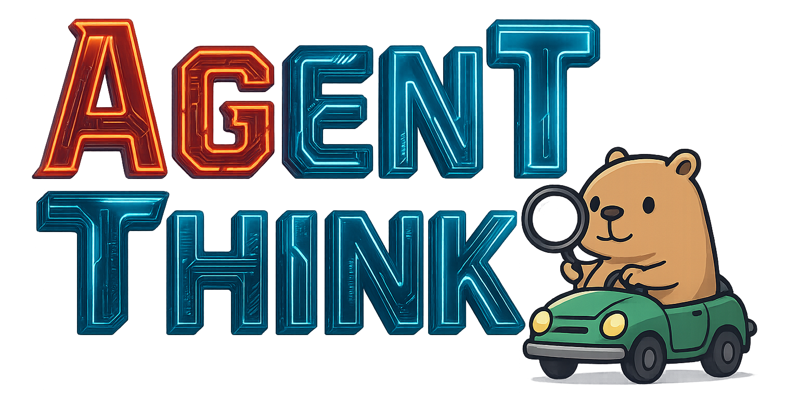
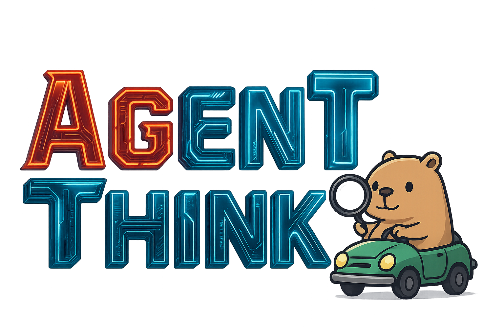
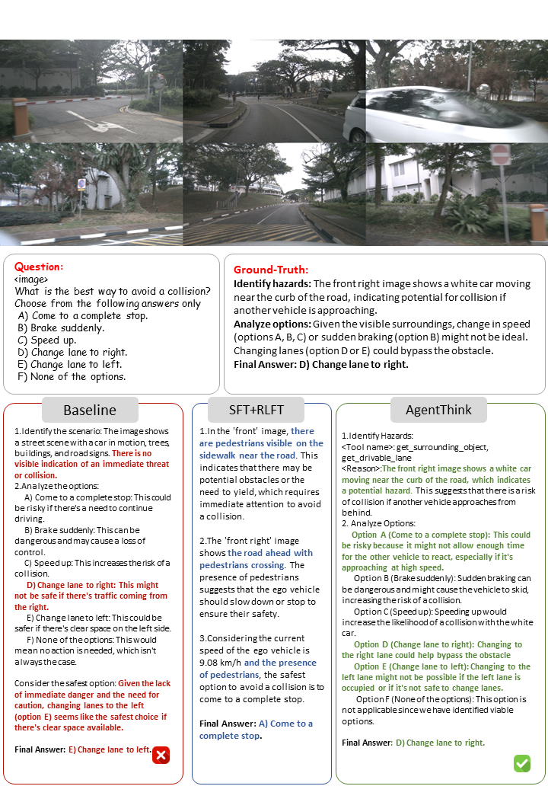
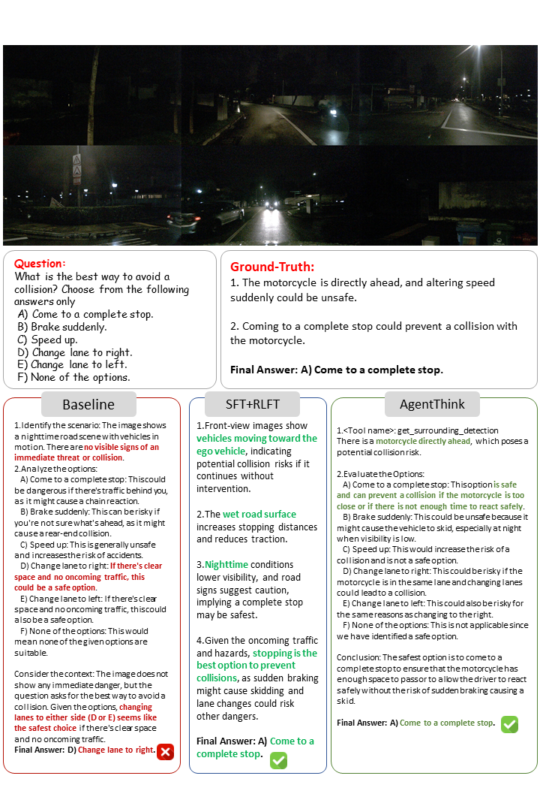
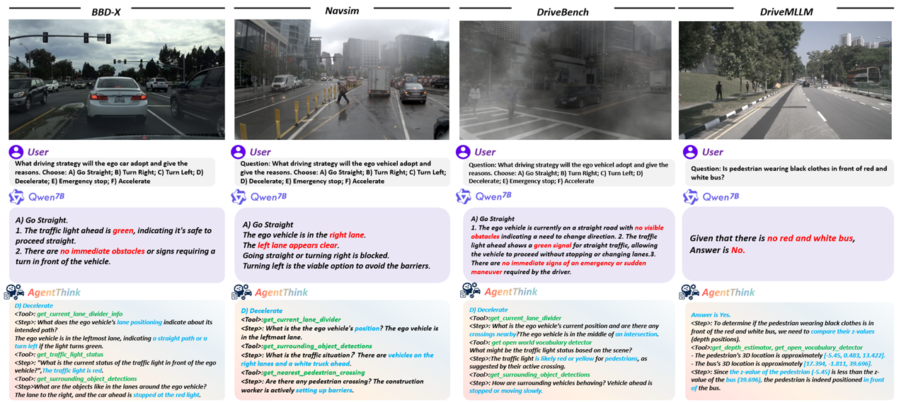

<div align="center">

<h1><b>🚗 AgentThink: A Unified Framework for Tool-Augmented Chain-of-Thought Reasoning in Vision-Language Models for Autonomous Driving</b></h1>



[中文](README_CN.md) ｜ **English**

<p>
  <a href="https://curryqka.github.io/AgentThink.github.io/">🌐 Project Page</a> •
  <a href="https://arxiv.org/pdf/2505.15298">📄 Paper (arXiv)</a> •
  <a href="https://aclanthology.org/2025.findings-emnlp.564/">📚 EMNLP 2025</a> •
  <a href="https://github.com/curryqka/AgentThink">🔖 Code</a> •
  <a href="LICENSE">🪪 Apache-2.0</a>
</p>
<p>
  <a href="https://drive.google.com/drive/folders/1RsgJlo3K7xRCUqphWvWECgyOcCvOa9Hx?usp=sharing">🪚 Model</a> |
  <a href="https://drive.google.com/drive/folders/1RsgJlo3K7xRCUqphWvWECgyOcCvOa9Hx?usp=sharing">🔢 Data</a> |
  <a href="https://github.com/curryqka/AgentThink/issues/2">🤗 Hugging Face mirror (tracking)</a>
</p>

<p>
  E-mails: <a href="mailto:qka23@mails.tsinghua.edu.cn">qka23@mails.tsinghua.edu.cn</a> ·
  <a href="mailto:sicong.jiang@mail.mcgill.ca">sicong.jiang@mail.mcgill.ca</a> ·
  <a href="mailto:luoziang0122@163.com">luoziang0122@163.com</a> ·
  <a href="mailto:zhongyangtony@163.com">zhongyangtony@163.com</a>
</p>

</div>

During the development of AgentThink we drew inspiration from ancient wisdom. As Xunzi said:

> 📜 "君子生非异也，善假于物也。"
>
> "A gentleman is not inherently different from others; he excels by skillfully leveraging external tools."

This philosophy is the design principle of AgentThink: combine multiple driving tools with an explicit reasoning chain to handle complex autonomous-driving questions.

---

## Contents

- [Highlights](#-highlights)
- [News](#-news)
- [Framework](#-framework)
- [Installation](#-installation)
- [Model & data](#-model--data)
- [Pipeline at a glance](#-pipeline-at-a-glance)
- [1. Tool-CoT data generation](#1-tool-cot-data-generation)
- [2. Two-stage training (SFT → GRPO)](#2-two-stage-training-sft--grpo)
- [3. Inference](#3-inference)
- [4. Evaluation](#4-evaluation)
- [Reproduction checklist](#-reproduction-checklist)
- [Benchmark results](#-benchmark-results)
- [Repository structure](#-repository-structure)
- [FAQ](#-faq)
- [License & citation](#-license--citation)

## ✨ Highlights

- 🔧 **Tool-augmented reasoning** — five driving-centric tool modules (visual, detection,
  prediction, occupancy, map) plus single-view vision utilities.
- 🧠 **Explicit Tool-CoT** — every reasoning step carries `Tool`, `Sub`,
  `Guess_Answer`, `key_words`, `Missing_flag` and `next_action`.
- 🎯 **Two-stage training** — SFT warms up reasoning and tool calls, GRPO refines them
  with final-answer, step-reasoning and tool-use rewards.
- 📊 **Tool-aware evaluation** — DriveLMM-o1 reasoning metrics plus three new
  tool-use metrics judged by an LLM.
- 🚀 **Results** — +51.9 % overall reasoning and +33.5 % MCQ over Qwen2.5-VL-7B on
  DriveLMM-o1.

<div align="center">
  
</div>

## 📰 News

- **2025.10** — Repository refactor: shared inference runner, training code, GRPO
  rewards, tool-use metrics, unit tests and a complete reproduction guide.
- **2025.08.20** — AgentThink was accepted to **EMNLP 2025 Findings**.
- **2025.07.02** — v1.1 released with demo and sample data.
- **2025.05.22** — Paper published on arXiv.

## 🧭 Framework

AgentThink has three components, mirroring Sec. 3 of the paper:

| Component | What it does | Code |
|---|---|---|
| **1. Data generation** | GPT-4o turns reference CoT into structured Tool-CoT; driving tools are executed on Agent-Driver perception results | `scripts/tools/` |
| **2. Two-stage training** | LoRA SFT (phase 1: actions, phase 2: actions + observations) followed by GRPO with three rewards | `training/` |
| **3. Inference & evaluation** | Dynamic tool invocation at inference; DriveLMM-o1 judge + tool-use metrics | `evaluation/` |

## ⚙️ Installation

### Requirements

| Component | Version |
|---|---|
| OS | Ubuntu 20.04 (Linux) |
| Python | 3.10 |
| CUDA Toolkit | 12.4 |
| PyTorch | 2.6.0 |
| GPU | NVIDIA A800 80 GB (paper: 16 GPUs) |

### Setup

```bash
git clone https://github.com/curryqka/AgentThink.git
cd AgentThink

conda create -n agentthink python=3.10 -y
conda activate agentthink
pip install -r requirements.txt

# ms-swift (inference + training engine)
# Requires 3.x: ms-swift 4.0 removed `swift.llm`, which inference/ imports.
bash scripts/env.sh

# optional: Qwen2.5-VL demo dependencies
export QWEN2_5_VL_DIR=/path/to/Qwen2.5-VL
bash scripts/env_drivemllm.sh

# make the repository importable
export PYTHONPATH="$PWD:$PYTHONPATH"
```

The third-party tool implementations are cloned separately:

```bash
cd third_party
git clone https://github.com/DepthAnything/Depth-Anything-V2.git
git clone https://github.com/AILab-CVC/YOLO-World.git
git clone https://github.com/modelscope/ms-swift.git ms-swift-main
```

Download `depth_anything_v2_vitb.pth` and `yolov8x-worldv2.pt` into
`pretrained_model/` (see the layout below).

## 📦 Model & data

| Artifact | Where | Notes |
|---|---|---|
| AgentThink checkpoint (merged, Qwen2.5-VL-7B) | [Google Drive](https://drive.google.com/drive/folders/1RsgJlo3K7xRCUqphWvWECgyOcCvOa9Hx?usp=sharing) | put under `pretrained_model/AgentThink` |
| DriveLMM-o1 train/test JSON | [Google Drive](https://drive.google.com/drive/folders/1RsgJlo3K7xRCUqphWvWECgyOcCvOa9Hx?usp=sharing) | `data/DriveLMMo1/` |
| Processed test JSONL + Tool-CoT data | [Google Drive](https://drive.google.com/drive/folders/1RsgJlo3K7xRCUqphWvWECgyOcCvOa9Hx?usp=sharing) | `data/` |
| Agent-Driver tool pickles | [Agent-Driver](https://github.com/USC-GVL/Agent-Driver) | `data/tool_results/{val,train}/` |
| Hugging Face mirror | tracked in [issue #2](https://github.com/curryqka/AgentThink/issues/2) | community help welcome |

Expected layout:

```text
AgentThink/
├── data/
│   ├── DriveLMMo1/
│   │   ├── DriveLMMo1_TRAIN.json
│   │   └── DriveLMMo1_TEST.json
│   ├── DriveLMMo1_TEST.jsonl                 # plain test set
│   ├── DriveLMMo1_TEST_tool_results.jsonl    # test set + tool observations
│   ├── image2concat/                         # 3 x 2 six-view collages
│   │   └── <scene_token>_<frame_token>.png
│   ├── tool_results/
│   │   ├── val/<frame_token>.pkl
│   │   └── train/<frame_token>.pkl
│   └── agentthink_sft_phase1.jsonl           # built by build_sft_data.py
├── pretrained_model/
│   ├── AgentThink/
│   ├── depth_anything_v2_vitb.pth
│   └── yolov8x-worldv2.pt
├── demo_image/
├── docs/
├── evaluation/
├── Inference/
├── scripts/
├── tests/
├── third_party/
└── training/
```

## 🚀 Pipeline at a glance

```text
DriveLMM-o1 QA + nuScenes images + Agent-Driver pickles
        │
        ├─(1a) GPT-4o Tool-CoT generation ──► final_cot_train_<model>.json
        ├─(1b) six-view collage ────────────► data/image2concat/*.png
        ├─(1c) execute planned tools ───────► cot_val_Qwen2.5-VL.json
        ├─(1d) JSONL conversion ────────────► DriveLMMo1_TEST_tool_results.jsonl
        └─(1e) build SFT/GRPO data ─────────► data/agentthink_*.jsonl
        │
        ├─(2) SFT phase 1 → SFT phase 2 → GRPO ──► merged checkpoint
        ├─(3) inference (plain / planner / AgentThink)
        └─(4) LLM-as-Judge evaluation
```

A detailed artifact table, reproduction checklist and FAQ live in
**[docs/pipeline.md](docs/pipeline.md)**.

## 1. Tool-CoT data generation

```bash
export OPENAI_API_KEY=...            # optionally OPENAI_BASE_URL=...

# (1a) Generate structured Tool-CoT from the reference answers
python scripts/tools/agentthink_data_generater_pipeline.py \
    --input data/DriveLMMo1/DriveLMMo1_TRAIN.json \
    --split train --model-name gpt-4o-mini \
    --output final_cot_train_gpt-4o-mini.json

# (1b) Stitch six cameras into one image per sample
python scripts/tools/data_image_converter.py \
    --json-file-path data/DriveLMMo1/DriveLMMo1_TEST.json \
    --image-root-dir /path/to/nuscenes \
    --savepath-img data/image2concat

# (1c) Execute the planned tools on the Agent-Driver perception pickles
python scripts/tools/gen_tool_result_data.py \
    --input final_cot_train_gpt-4o-mini.json \
    --output data/tool_results/cot_val_Qwen2.5-VL.json \
    --tool-data-path data/tool_results --split val

# (1d) Convert to the evaluation JSONL
python evaluation/prepare_data.py \
    --input data/tool_results/cot_val_Qwen2.5-VL.json \
    --output data/DriveLMMo1_TEST_tool_results.jsonl
```

> `tool_result` in the JSONL is **not** model output. It is the output of the
> driving tools executed in step (1c). `system_prompts` contains the ego-state
> description. See [docs/pipeline.md](docs/pipeline.md#1c-execute-the-planned-tools).

## 2. Two-stage training (SFT → GRPO)

Training scripts follow Appendix B of the paper (LoRA r=8, α=32; SFT 20 epochs,
lr 1e-4; GRPO 8 epochs, lr 1e-5, 2 rollouts, β=0.001).

```bash
export PYTHONPATH=$PWD

# Build tool-aware training data
python scripts/tools/build_sft_data.py \
    --input data/tool_results/cot_val_Qwen2.5-VL.json \
    --output data/agentthink_sft_phase1.jsonl \
    --format agentthink --target sft --no-observations
python scripts/tools/build_sft_data.py \
    --input data/tool_results/cot_val_Qwen2.5-VL.json \
    --output data/agentthink_sft_phase2.jsonl \
    --format agentthink --target sft
python scripts/tools/build_sft_data.py \
    --input data/tool_results/cot_val_Qwen2.5-VL.json \
    --output data/agentthink_grpo.jsonl \
    --format agentthink --target grpo

# Train
NPROC_PER_NODE=8 bash training/sft.sh phase1 data/agentthink_sft_phase1.jsonl
ADAPTERS=<phase1_adapter> NPROC_PER_NODE=8 \
  bash training/sft.sh phase2 data/agentthink_sft_phase2.jsonl
ADAPTERS=<phase2_adapter> NPROC_PER_NODE=8 \
  bash training/grpo.sh Qwen/Qwen2.5-VL-7B-Instruct data/agentthink_grpo.jsonl

# Merge the adapter for inference
bash training/merge_lora.sh <grpo_adapter> pretrained_model/AgentThink
```

Hardware guidance (1/2/4/8 GPUs), reward details and troubleshooting:
**[training/README.md](training/README.md)**.

## 3. Inference

Three modes answer three different questions:

| Command | Input | Purpose |
|---|---|---|
| `evaluation/inference.py` | `DriveLMMo1_TEST.jsonl` | plain CoT baseline |
| `evaluation/inference_withtool.py` | `DriveLMMo1_TEST.jsonl` + tool catalog | structured **tool planning** (no execution) |
| `evaluation/inference_agentthink.py` | `DriveLMMo1_TEST_tool_results.jsonl` | **AgentThink**: answer conditioned on tool observations |

```bash
CKPT=pretrained_model/AgentThink

bash scripts/inference_scripts/inference.sh           "$CKPT" baseline
bash scripts/inference_scripts/inference_withtool.sh  "$CKPT" toolcot
bash scripts/inference_scripts/inference_agentthink.sh "$CKPT" AgentThink
```

All scripts take `--limit N` for a smoke test and support `torchrun` through
`NPROC_PER_NODE`. A plain `python evaluation/inference.py ...` also works on a
single GPU.

Interactive demos:

```bash
python Inference/inference_demo_drivemllm.py --model-path "$CKPT"
python Inference/inference_demo_drivelmm.py  --model-path "$CKPT" \
    --tool-data-path data/tool_results
```

## 4. Evaluation

```bash
export OPENAI_API_KEY=...
python evaluation/evaluation_script.py \
    --input results/agentthink/DriveLMMo1_AgentThink.json \
    --dataset data/DriveLMMo1/DriveLMMo1_TEST.json \
    --output results/agentthink_eval \
    --tool-metrics
```

The judge returns the twelve DriveLMM-o1 scores, the seven Table 3 columns, MCQ
accuracy, and — with `--tool-metrics` — the three tool-use scores of Table 2.
Results are written as `.json`, `.csv` and `.summary.json`.

## ✅ Reproduction checklist

1. Use the **merged AgentThink checkpoint**, not the base model.
2. Use the **six-view collage** (`data/image2concat/<stem>.png`), not a single camera.
3. Use `DriveLMMo1_TEST_tool_results.jsonl` for AgentThink inference.
4. Keep `--max-new-tokens` large enough (2000) so the final answer is not truncated.
5. Judge with `gpt-4o-mini`, temperature 0; expect ±1–2 points of judge drift.
6. Sanity check: base Qwen2.5-VL-7B MCQ = 37.81, DriveLMM-o1 = 62.36, AgentThink = 71.35.

The full checklist with failure modes is in
[docs/pipeline.md](docs/pipeline.md#5-reproduction-checklist-issue-6).

## 📊 Benchmark results

### DriveLMM-o1

| Vision Language Models | Risk Assess. (%)↑ | Rule Adh. (%)↑ | Scene Aware. (%)↑ | Relevance (%)↑ | Missing (%)↑ | Reason. (%)↑ | MCQ (%)↑ |
|---|---|---|---|---|---|---|---|
| [GPT-4o](https://github.com/gpt4o-image/GPT-4o) | 71.32 | 80.72 | 72.96 | 76.65 | 71.43 | 72.52 | 57.84 |
| [Ovis1.5-Gemma2-9B](https://huggingface.co/AIDC-AI/Ovis1.5-Gemma2-9B) | 51.34 | 66.36 | 54.74 | 55.72 | 55.74 | 55.62 | 48.85 |
| [Mulberry-7B](https://github.com/HJYao00/Mulberry) | 51.89 | 63.66 | 56.68 | 57.27 | 57.45 | 57.65 | 52.86 |
| [LLaVA-CoT](https://github.com/PKU-YuanGroup/LLaVA-CoT) | 57.62 | 69.01 | 60.84 | 62.72 | 60.67 | 61.41 | 49.27 |
| [LlamaV-o1](https://github.com/mbzuai-oryx/LlamaV-o1) | 60.20 | 73.52 | 62.67 | 64.66 | 63.41 | 63.13 | 50.02 |
| [InternVL2.5-8B](https://huggingface.co/OpenGVLab/InternVL2_5-8B) | 69.02 | 78.43 | 71.52 | 75.80 | 70.54 | 71.62 | 54.87 |
| [Qwen2.5-VL-7B](https://github.com/QwenLM/Qwen2.5-VL) | 46.44 | 60.45 | 51.02 | 50.15 | 52.19 | 51.77 | 37.81 |
| [DriveLMM-o1](https://github.com/ayesha-ishaq/DriveLMM-o1) | 73.01 | 81.56 | 75.39 | 79.42 | 74.49 | 75.24 | 62.36 |
| **AgentThink (Ours)** | **80.51** | **84.98** | **82.11** | **84.99** | **79.56** | **79.68** | **71.35** |

### Tool-use metrics (Table 5)

| Model variant | Tool Usage Appro. | Tool Chain Coh. | Percep-Guided Tool Align. | Overall Tool Score |
|---|---|---|---|---|
| Base + DirectTool | 59.61 | 73.29 | 69.71 | 67.54 |
| Base + SFT | 62.38 | 78.19 | 75.78 | 72.12 |
| Base + GRPO | 68.44 | 80.73 | 80.82 | 76.66 |
| **AgentThink (Ours)** | **70.92** | **82.16** | **84.25** | **79.11** |

### DriveMLLM

| Type | Model | L/R | F/B | RHD | RD | PPos | BBox | CVD | CD | AccS | Overall |
|---|---|---|---|---|---|---|---|---|---|---|---|
| Zero-shot | [GPT-4o](https://github.com/gpt4o-image/GPT-4o) | 91.72 | 67.60 | 9.58 | 14.69 | 40.90 | 4.07 | 46.11 | 70.65 | 43.16 | 25.63 |
| | [GPT-4o-mini](https://openai.com/zh-Hans-CN/index/gpt-4o-mini-advancing-cost-efficient-intelligence/) | 67.67 | 50.13 | 70.44 | 0.00 | 29.28 | 3.78 | 0.00 | 46.40 | 33.46 | 16.68 |
| | [LLaVA-ov-72B](https://huggingface.co/llava-hf/llava-onevision-qwen2-72b-ov-hf) | 85.42 | 49.48 | 13.76 | 45.27 | 16.46 | 0.00 | 42.97 | 27.09 | 35.06 | 21.10 |
| | [Qwen2.5-VL-7B](https://github.com/QwenLM/Qwen2.5-VL) | 76.55 | 55.24 | 7.14 | 17.11 | 55.97 | 38.31 | 55.94 | 51.52 | 44.72 | 13.36 |
| | Qwen + CoT | 87.06 | 63.09 | 16.69 | 22.56 | 52.51 | 38.87 | 76.90 | 38.71 | 49.55 | 19.31 |
| | Qwen + DirectTool | 78.95 | 48.96 | 58.43 | 67.57 | 58.20 | 42.22 | 51.76 | 51.38 | 57.18 | 24.05 |
| | **AgentThink (Ours)** | 82.33 | 54.40 | 56.14 | 61.45 | 70.45 | 56.23 | 23.09 | 51.60 | 56.96 | 26.52 |
| One-shot | [GPT-4o](https://github.com/gpt4o-image/GPT-4o) | 91.08 | 69.37 | 36.51 | 71.17 | 42.44 | 5.10 | 0.00 | 63.88 | 47.44 | 33.17 |
| | [GPT-4o-mini](https://openai.com/zh-Hans-CN/index/gpt-4o-mini-advancing-cost-efficient-intelligence/) | 66.00 | 48.95 | 83.02 | 58.47 | 25.71 | 3.97 | 52.73 | 55.23 | 49.26 | 22.13 |
| | [LLaVA-ov-72B](https://huggingface.co/llava-hf/llava-onevision-qwen2-72b-ov-hf) | 79.12 | 62.97 | 49.26 | 68.04 | 28.57 | 2.20 | 53.12 | 60.90 | 50.52 | 36.66 |
| | [Qwen2.5-VL-7B](https://github.com/QwenLM/Qwen2.5-VL) | 80.30 | 53.14 | 36.96 | 39.13 | 62.69 | 22.63 | 49.88 | 48.32 | 49.13 | 33.53 |
| | Qwen + CoT | 86.35 | 59.95 | 43.29 | 31.81 | 53.64 | 26.93 | 51.02 | 42.30 | 49.41 | 32.06 |
| | Qwen + DirectTool | 84.57 | 55.50 | 67.32 | 59.54 | 85.58 | 26.07 | 52.34 | 53.25 | 60.52 | 42.27 |
| | **AgentThink (Ours)** | 78.71 | 48.46 | 60.64 | 60.71 | 72.36 | 64.46 | 52.26 | 52.04 | 61.21 | 47.24 |

## 🎬 Demo showcase

<p align="center">
  
</p>

<div style="display: flex; justify-content: center; flex-wrap: wrap; gap: 20px; margin: 20px 0;">
  
  
</div>

<p align="center">
  
</p>

| Scenario | Description | Image |
|---|---|---|
| High-level planning | Daytime planning output | [View](assets/planning.png) |
| Environment adaptability | Night / low-light planning | [View](assets/planning-night.png) |
| Spatial understanding | Zero-shot spatial relations | [View](assets/zero-visual.png) |

## 📁 Repository structure

```text
AgentThink/
├── assets/                       # figures and demo media
├── demo_image/                   # demo camera images
├── docs/
│   └── pipeline.md               # artifact contract + reproduction checklist
├── evaluation/
│   ├── prompts.py                # all model-visible prompts
│   ├── runner.py                 # shared dataset / distributed / generation
│   ├── inference.py              # plain CoT
│   ├── inference_withtool.py     # structured tool planning
│   ├── inference_agentthink.py   # AgentThink with tool observations
│   ├── evaluation_script.py      # DriveLMM-o1 judge + MCQ
│   ├── tool_metrics.py           # Table 2 tool-use metrics
│   └── prepare_data.py           # tool-result JSON -> evaluation JSONL
├── Inference/
│   ├── qwen2_5vl.py              # shared Qwen2.5-VL interface
│   └── inference_demo_*.py       # interactive demos
├── scripts/
│   ├── env.sh / env_drivemllm.sh
│   ├── inference_scripts/        # torchrun launchers
│   ├── debug_scripts/
│   └── tools/
│       ├── tool_libraries.py     # driving-centric tools
│       ├── tool_libraries_simple.py
│       ├── function_schema.py    # tool catalog rendering
│       ├── tool_chain.py         # Tool-CoT parsing / validation
│       ├── chain_render.py       # training trace rendering
│       ├── agentthink_data_generater_pipeline.py
│       ├── gen_tool_result_data.py
│       ├── build_sft_data.py
│       ├── prepare_swift_data.py
│       ├── data_image_converter.py
│       ├── rewards.py            # GRPO rewards (Table 1)
│       ├── utils/
│       └── debug_tools/
├── tests/                        # 30 dependency-free unit tests
├── training/
│   ├── README.md                 # hardware + data + commands
│   ├── sft.sh / grpo.sh
│   └── merge_lora.sh
├── third_party/                  # YOLO-World, Depth-Anything, ms-swift
├── LICENSE
├── requirements.txt
├── README.md
└── README_CN.md
```

## ❓ FAQ

**Can I run this on 2 or 4 A800 GPUs?**

Inference: yes, 1 × 80 GB is enough for a merged 7B model. SFT: 4 × A800 works with
the default settings, 2 × A800 with a smaller `--max_length`. GRPO: 4 × 80 GB is
the practical minimum with a reduced completion length; the paper used 16 × A800.
See [training/README.md](training/README.md#2-hardware).

**Why does `inference_withtool.py` not answer the question?**

It is the tool **planner**: it emits the structured chain that
`gen_tool_result_data.py` executes. The answering script is
`inference_agentthink.py`. This separation is what the paper calls the data
generation and inference stages.

**Where does `tool_result` come from?**

From executing the planned tools on Agent-Driver perception pickles — not from
the VLM. Details in [docs/pipeline.md](docs/pipeline.md#1c-execute-the-planned-tools).

**I cannot reproduce MCQ 71.35.**

Work through the six-point checklist in
[docs/pipeline.md](docs/pipeline.md#5-reproduction-checklist-issue-6). The most
common causes are using the base model, a single-camera image instead of the
collage, empty `tool_result`, or a truncated generation.

## 🔗 Related work

| Name | Description | Link |
|---|---|---|
| Depth-Anything-V2 | Monocular depth estimation | [GitHub](https://github.com/DepthAnything/Depth-Anything-V2) |
| YOLO-World | Open-vocabulary object detection | [GitHub](https://github.com/AILab-CVC/YOLO-World) |
| all-MiniLM-L6-v2 | Sentence semantic similarity | [HuggingFace](https://huggingface.co/sentence-transformers/all-MiniLM-L6-v2) |
| Agent-Driver | Driving tool results and pickles | [GitHub](https://github.com/USC-GVL/Agent-Driver) |
| DriveLMM-o1 | Benchmark and evaluation protocol | [GitHub](https://github.com/ayesha-ishaq/DriveLMM-o1) |

## 🪪 License & citation

This project is released under the [Apache License 2.0](LICENSE).

```bibtex
@inproceedings{qian2025agentthink,
  title     = {{AgentThink}: A Unified Framework for Tool-Augmented Chain-of-Thought
               Reasoning in Vision-Language Models for Autonomous Driving},
  author    = {Qian, Kangan and Jiang, Sicong and Zhong, Yang and Luo, Ziang and
               Huang, Zilin and Zhu, Tianze and Jiang, Kun and Yang, Mengmeng and
               Fu, Zheng and Miao, Jinyu and others},
  booktitle = {Findings of the Association for Computational Linguistics: EMNLP 2025},
  pages     = {10663--10682},
  year      = {2025},
  url       = {https://aclanthology.org/2025.findings-emnlp.564/}
}
```

An earlier version is available as [arXiv:2505.15298](https://arxiv.org/abs/2505.15298).

> **Authors:** Kangan Qian\*, Sicong Jiang\*, Yang Zhong\*, Ziang Luo\*, Zilin Huang,
> Tianze Zhu, Kun Jiang†, Mengmeng Yang, Zheng Fu, Jinyu Miao, Yining Shi,
> He Zhe Lim, Li Liu, Tianbao Zhou, Huang Yu, Yifei Hu, Guang Li, Guang Chen,
> Hao Ye†, Lijun Sun, Diange Yang†
>
> **Affiliations:** ¹ Tsinghua University · ² McGill University ·
> ³ Xiaomi Corporation · ⁴ University of Wisconsin–Madison
>
> \* Equal contribution · † Corresponding author
